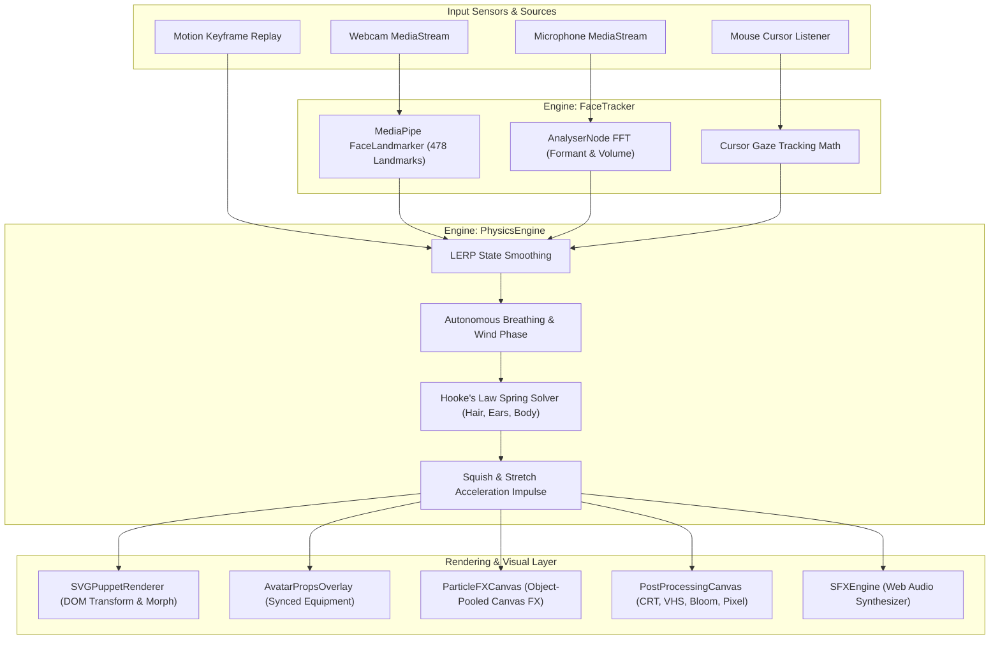

# 🏛️ SVG-TUBER System Architecture

This document details the core architectural design, data pipelines, physics mathematics, and engine components powering SVG-TUBER ULTIMATE.

---

## 📐 High-Level Data Flow Architecture

---

## 🧩 Core Engine Modules

### 1. `FaceTracker` ([src/engine/FaceTracker.ts](file:///c:/Users/media/OneDrive/Desktop/SVG-TUBER/src/engine/FaceTracker.ts))
- **Landmark Detection**: Uses Google MediaPipe `@mediapipe/tasks-vision` `FaceLandmarker` with 478 3D landmarks.
- **Head Rotation Matrix**: Calculates head Roll via `atan2(dY, dX)` across outer eye corners, Yaw via nose-to-eye center ratio, and Pitch via nose vertical displacement.
- **Eye Aspect Ratio (EAR)**: Computes EAR for left and right eyes to determine blink ratios (`< 0.25` indicates closed eye).
- **Formant & Viseme Detection**: Analyzes 512-bin FFT frequency spectrum from microphone input:
  - High energy dominance -> `I` / `E`
  - Mid energy dominance -> `A` / `O`
  - Low energy dominance -> `U` / `M`

### 2. `PhysicsEngine` ([src/engine/PhysicsEngine.ts](file:///c:/Users/media/OneDrive/Desktop/SVG-TUBER/src/engine/PhysicsEngine.ts))
- **Hooke's Law Spring Simulation**:
  $$\text{Force} = -k \cdot (x - x_{\text{target}}) - c \cdot v$$
  Used for hair sway, ear bounce, body sway, and speech bounce.
- **Anime Squish & Stretch**: Calculates head movement acceleration ($\Delta \text{yaw} + \Delta \text{pitch}$). Rapid head turns impart squish impulses ($Y$ scale compresses while $X$ scale expands to maintain visual mass volume conservation).

### 3. `SFXEngine` ([src/engine/SFXEngine.ts](file:///c:/Users/media/OneDrive/Desktop/SVG-TUBER/src/engine/SFXEngine.ts))
- **Procedural Web Audio Synthesis**: Zero external audio asset downloads. Synthesizes cute ascending pentatonic chimes (C5->E5->G5->C6), heart bubble pops, low anger rumbles, electro zaps, and water drops using `OscillatorNode` and exponential gain ramps.

### 4. `MotionRecorder` ([src/engine/MotionRecorder.ts](file:///c:/Users/media/OneDrive/Desktop/SVG-TUBER/src/engine/MotionRecorder.ts))
- **Keyframe Pose Recording**: Captures tracking frames up to 10,000 keyframes with O(1) in-place array buffer mutation.
- **Linear Interpolation Playback**: Smoothly interpolates keyframes during replay loops.

---

## 🖥️ UI Component Layer

- **`SVGPuppetRenderer`**: Renders avatar SVG DOM, updates group transforms (`translate`, `rotate`, `scale`, `skew`), toggles eye blink elements, morphs mouth shapes, and updates expression layer visibilities. Uses `WeakMap` transform caching to eliminate redundant 60 FPS DOM writes.
- **`ControlDashboard`**: Tabbed UI panel for selecting avatars, equipping props, triggering chat commands, recording keyframe poses, and toggling post-processing filters.
- **`RiggingStudio`**: SVG file parser and layer ID tagging interface for custom avatars.
- **`OverlayView`**: Stripped-down full-screen view for OBS browser source integration (`#obs`).
